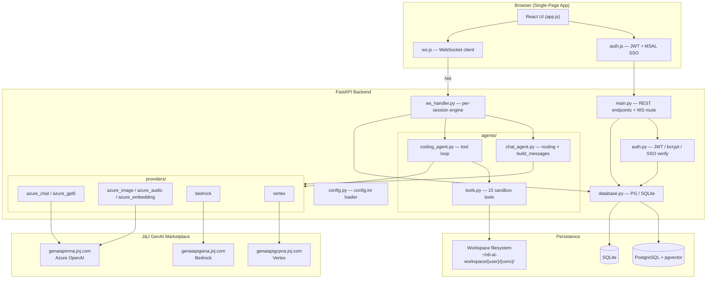
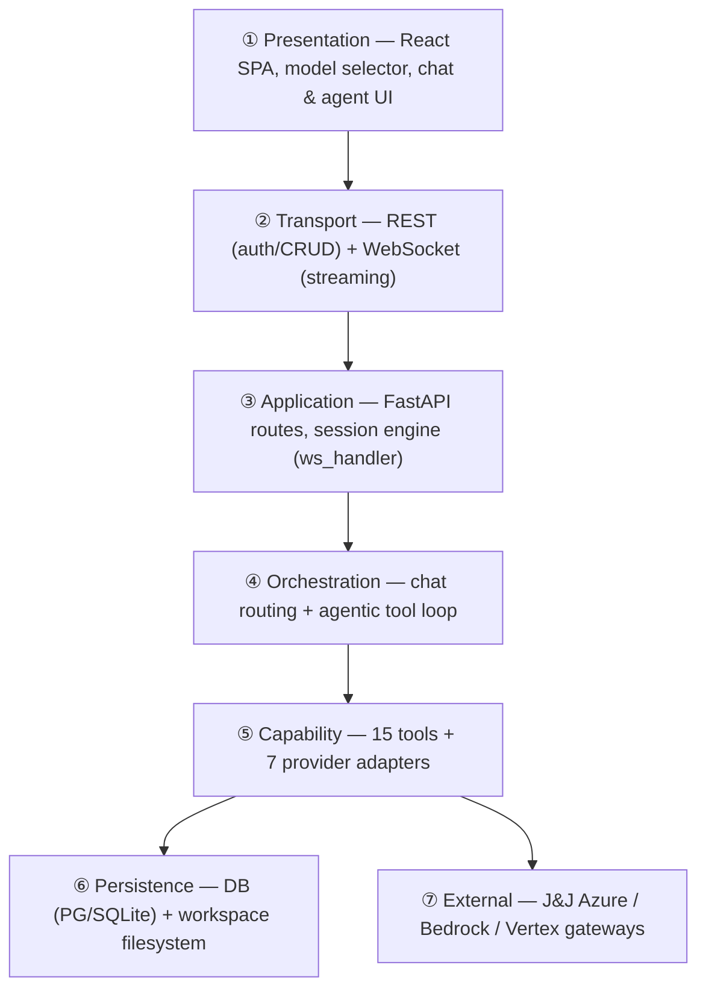
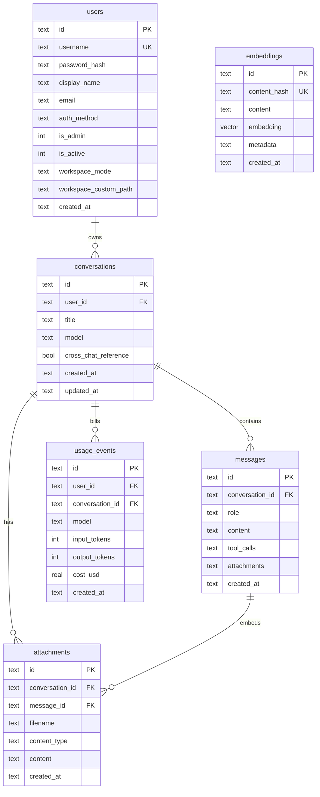
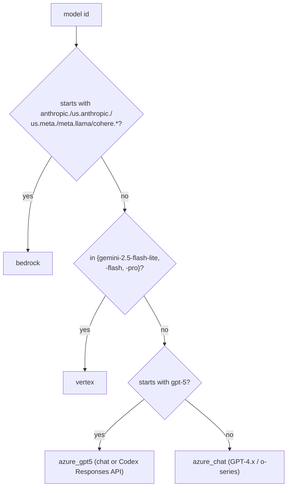
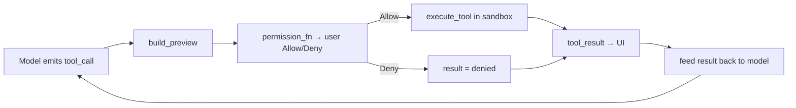
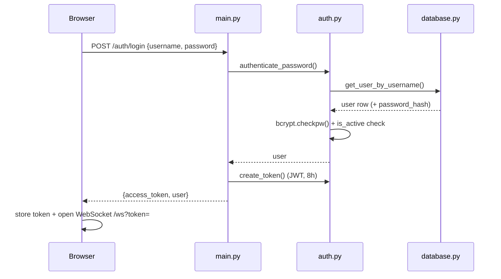
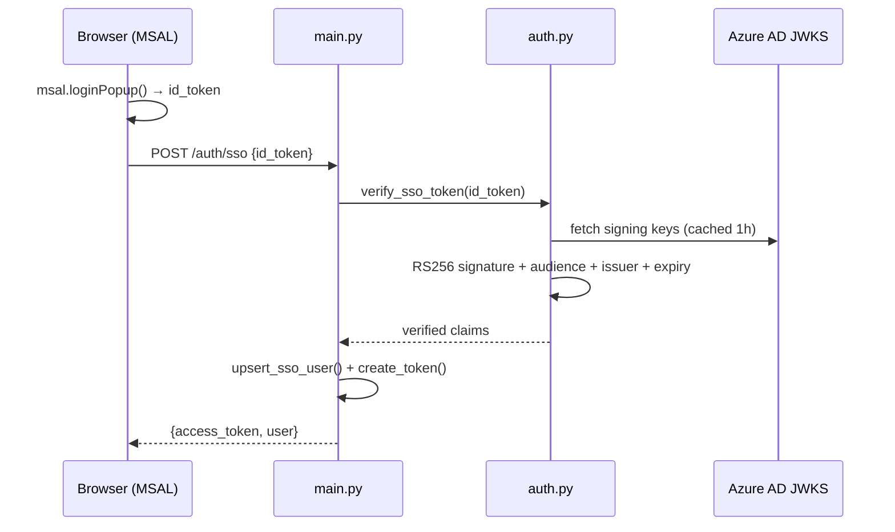
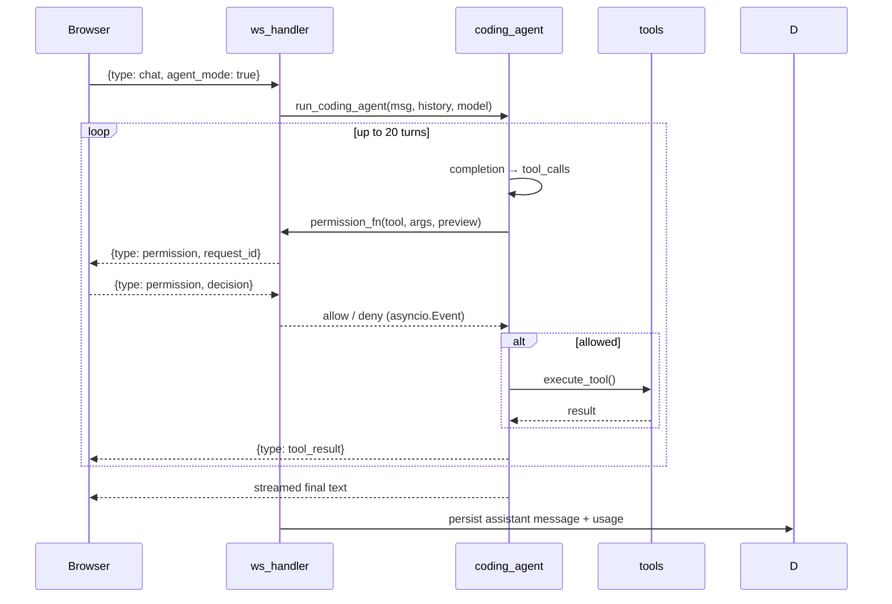
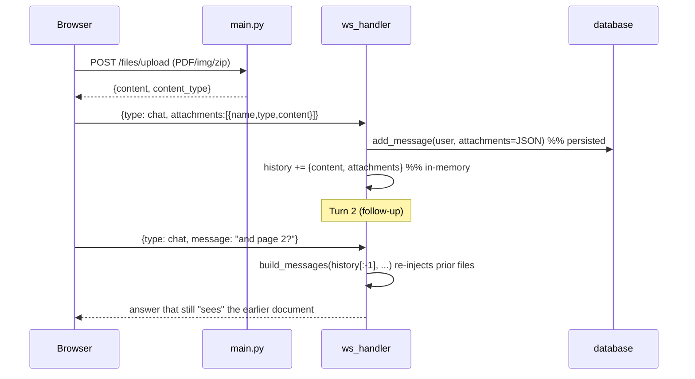
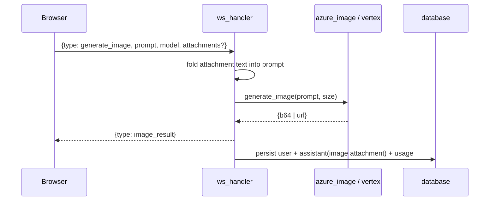

# RDI AI — Complete Technical Report & Architecture Guide

**Document date:** 2026-07-05
**Application:** RDI AI (Research & Development Intelligence) — enterprise GenAI platform for Johnson & Johnson
**Version:** 1.0.0 (post fix-pass, session 5)
**Companion visual:** [`RDI_AI_Visual_Explainer_2026-07-05.html`](RDI_AI_Visual_Explainer_2026-07-05.html) — open in a browser for the animated 3D architecture, motion flow diagrams, and before/after visuals.

> This report documents **every** part of the codebase: the architecture, every file, every data flow, the data model, the model catalog, the agent tool system, the security model, configuration, run instructions — and a full **before → after** account of the fixes applied on 2026-07-05.

---

## Table of contents

1. [Executive summary](#1-executive-summary)
2. [Technology stack](#2-technology-stack)
3. [High-level architecture](#3-high-level-architecture)
4. [3D layered architecture](#4-3d-layered-architecture)
5. [Repository map — every file](#5-repository-map--every-file)
6. [Backend deep-dive](#6-backend-deep-dive)
7. [Frontend deep-dive](#7-frontend-deep-dive)
8. [Data model (ER diagram)](#8-data-model-er-diagram)
9. [Model catalog & routing](#9-model-catalog--routing)
10. [Agent tool system](#10-agent-tool-system)
11. [Key flows (sequence diagrams)](#11-key-flows-sequence-diagrams)
12. [WebSocket & REST protocol reference](#12-websocket--rest-protocol-reference)
13. [Security model](#13-security-model)
14. [Configuration](#14-configuration)
15. [Setup & run](#15-setup--run)
16. [What changed — previous → current](#16-what-changed--previous--current)
17. [Known limitations & future work](#17-known-limitations--future-work)

---

## 1. Executive summary

RDI AI is a full-stack, multi-provider AI platform that behaves like **"Claude chat + Claude Code combined"** in one web app, running entirely over Johnson & Johnson's internal GenAI API Marketplace gateways. It offers:

- **Chat mode** — streaming conversations across ~40 models (GPT-4.x, GPT-5.x, o-series reasoning, Claude on Bedrock, Gemini on Vertex).
- **Agent mode** — an agentic tool loop that can write & run code, create Office documents (PDF/PPTX/DOCX/XLSX), search & crawl the web, and generate images, all inside a per-conversation sandbox workspace with per-tool user permission prompts.
- **Multimodal** — image generation (DALL-E / Imagen), text-to-speech, speech-to-text (with diarization), and file/image attachments used as model context.
- **Enterprise features** — JWT + password auth, Azure AD SSO, an admin panel (users, usage stats, cost monitoring), per-user & per-conversation workspaces, conversation export (PDF/DOCX), cross-chat reference, and a live activity feed.

The backend is **FastAPI** (async), the frontend is a **build-less React** SPA (Babel-in-browser), and persistence is **dual-mode**: PostgreSQL + pgvector when configured, else SQLite for local development.

---

## 2. Technology stack

| Layer | Technology |
|---|---|
| Frontend framework | React 18 (UMD) + Babel Standalone (in-browser JSX, no build step) |
| Frontend libs | Marked (markdown), DOMPurify (sanitization), Prism (syntax highlight), MSAL Browser (Azure AD SSO) |
| Backend framework | FastAPI + Uvicorn (ASGI) |
| Realtime | WebSocket (`/ws`) for chat/agent streaming + bidirectional control |
| Auth | `python-jose` (JWT HS256), `bcrypt` (password hashing), Azure AD (MSAL + JWKS verification) |
| Database | asyncpg (PostgreSQL + pgvector) **or** aiosqlite (SQLite fallback) |
| LLM SDKs | `openai` (Azure OpenAI), `boto3` (Bedrock Converse), `google-genai` (Vertex) |
| Documents | fpdf2 (PDF), python-pptx (PPTX), python-docx (DOCX), openpyxl (XLSX) |
| Web tools | BeautifulSoup + urllib (crawl/search), Playwright (optional JS rendering) |
| Files | PyPDF2 (PDF text extract), python-docx (DOCX extract), zipfile (ZIP extract) |

---

## 3. High-level architecture



**Two request planes:**
- **REST plane** (`main.py`) — auth, conversation CRUD, file upload, workspace file API, admin, export, provider status.
- **WebSocket plane** (`ws_handler.py`) — everything realtime: chat streaming, agent tool loop, permissions, image/audio, activity feed.

---

## 4. 3D layered architecture

The system is best understood as **seven stacked layers**, each depending only on the one below it. The companion HTML explainer animates this stack in 3D.



---

## 5. Repository map — every file

```
RDI-AI-Assistant/
├── run.py                          # Dev/prod launcher (uvicorn wrapper)
├── requirements.txt                # Python dependencies
├── config.ini                      # API keys, endpoints, SSO (user-provided)
├── create_project.py               # One-shot project bootstrap script
├── test_endpoints.py               # Standalone marketplace connectivity test suite
├── .gitignore                      # Ignores .jwt_secret, rdi_ai.db, __pycache__
├── backend/
│   ├── __init__.py
│   ├── main.py                     # FastAPI app: REST endpoints + WS route + export
│   ├── config.py                   # config.ini → typed dataclasses; JWT secret; paths
│   ├── auth.py                     # JWT create/decode, bcrypt verify, Azure SSO verify
│   ├── database.py                 # Dual PG/SQLite async layer; schema; pricing; usage
│   ├── ws_handler.py               # WSSession: routes every WS message; agent/chat glue
│   ├── agents/
│   │   ├── __init__.py
│   │   ├── chat_agent.py           # Provider routing + build_messages + trim_history
│   │   ├── coding_agent.py         # Agentic loop (tool call → permission → execute)
│   │   └── tools.py                # 15 tool defs + executors + PDF/PPTX/DOCX/XLSX
│   └── providers/
│       ├── __init__.py
│       ├── azure_chat.py           # GPT-4.x, o-series, o3-pro (Responses API)
│       ├── azure_gpt5.py           # GPT-5.x chat + Codex (Responses API)
│       ├── azure_image.py          # gpt-image-1/1.5/2 generate + edit
│       ├── azure_audio.py          # TTS + transcription (+ diarization)
│       ├── azure_embedding.py      # text-embedding-3-large/small
│       ├── bedrock.py              # Claude/Llama/Cohere via Converse API
│       └── vertex.py               # Gemini chat + Imagen image gen
├── frontend/
│   ├── index.html                  # CDN loader for React/Babel/Marked/DOMPurify/Prism/MSAL
│   ├── css/app.css                 # Full theme (light/dark), all component styles
│   └── js/
│       ├── auth.js                 # Token storage, password + SSO (MSAL) login
│       ├── ws.js                   # WebSocket client with auto-reconnect + dispatch
│       └── app.js                  # Entire React app (~2180 lines, all components)
└── workspace/                      # (legacy) — actual files now under ~/rdi-ai-workspace/
```

---

## 6. Backend deep-dive

### 6.1 `main.py` — FastAPI application
Entry point. Mounts static frontend, defines all REST endpoints, the conversation export (PDF/DOCX), and the `/ws` WebSocket route. Key groups:

- **Auth:** `POST /auth/login`, `POST /auth/sso`, `GET /auth/me`, `GET /auth/sso-config`.
- **Conversations:** `GET /conversations`, `DELETE /conversations/{id}`, `PATCH /conversations/{id}`.
- **Files:** `POST /files/upload` (images→base64, PDF/DOCX→text extraction, ZIP→bulk text extraction with caps).
- **Workspace:** list / read / download / delete, all scoped by `_user_safe_path` (path-traversal-guarded, honors local workspace mode).
- **Admin:** users list/create/reset-password/toggle, stats, costs.
- **Export:** `GET /conversations/{id}/export?format=pdf|docx`.
- **Provider status:** `GET /providers/status`.

### 6.2 `config.py` — configuration loader
Parses `config.ini` into typed dataclasses (`AzureChatConfig`, `BedrockConfig`, `VertexConfig`, `SSOConfig`, `DatabaseConfig`, etc.). A card is **enabled only if its api_key is not a `YOUR_*` placeholder**. Resolves the workspace directory (outside the project to avoid dev auto-reload storms), the DB path, and a **persistent JWT secret** (env → config → `.jwt_secret` file).

### 6.3 `auth.py` — authentication
- `create_token` / `decode_token` — JWT HS256, 8-hour expiry.
- `authenticate_password` — bcrypt verify + `is_active` check.
- `get_current_user` / `get_admin_user` / `ws_auth` — FastAPI dependencies; all enforce `is_active`.
- `verify_sso_token` — **cryptographically verifies** an Azure AD ID token (RS256 signature against cached JWKS, audience, issuer, expiry).

### 6.4 `database.py` — persistence
Dual-mode: PostgreSQL (asyncpg) when `[database]`/`RDI_DATABASE_URL` is present, else SQLite (aiosqlite). Contains the schema for both, migrations, the model **pricing table** (`_PRICING`, longest-key-first matching), `record_usage` / `get_cost_stats`, cross-chat summaries, attachments, and admin queries.

### 6.5 `ws_handler.py` — the session engine
`WSSession` holds per-connection state (`conversation_id`, `model`, `history`, workspace settings, pending permission events). `handle()` routes every inbound WS message type. Owns the chat path (`_handle_chat` → `build_messages` → `stream_response`), the agent path (`_run_coding_agent`), image/TTS/transcription, and the permission pause/resume via `asyncio.Event`.

### 6.6 `agents/chat_agent.py`
`_route(model)` decides the provider. `build_messages` assembles the OpenAI-style message array **including multimodal attachments from history** (so follow-ups keep file context). `trim_history` is a char-budget sliding window (drops oldest first).

### 6.7 `agents/coding_agent.py`
The agentic loop (`MAX_TURNS = 20`): completion → for each tool call → `permission_fn` (awaits user Allow/Deny) → `execute_tool` → feed result back. `_normalize_tool_call` handles **both** OpenAI objects and Bedrock dicts so any provider can drive the loop.

### 6.8 `agents/tools.py`
15 tool definitions (OpenAI function-calling schema) + executors, all confined to the active workspace via `_safe_path` (uses `is_relative_to`). Includes the document generators (`create_pdf/pptx/docx/excel`) and `pdf_safe_text` (Latin-1 transliteration so PDFs never crash on Unicode).

### 6.9 `providers/*`
| Provider | Models | Notes |
|---|---|---|
| `azure_chat` | GPT-3.5/4/4o/4.1, o1/o3/o4, o3-pro | o-series drops system prompt & uses `max_completion_tokens`; o3-pro uses the Responses API |
| `azure_gpt5` | GPT-5.x chat, all Codex | Codex uses the Responses API (`codex_responses_api`) |
| `azure_image` | gpt-image-1/1.5/2 | `generate` + `edit` (inpainting) |
| `azure_audio` | gpt-4o-mini-tts, gpt-4o-transcribe(+diarize) | MIME inferred from filename |
| `azure_embedding` | text-embedding-3-large/small | For RAG (infrastructure ready) |
| `bedrock` | Claude, Llama, Cohere | Converse API; dummy AWS creds + `x-api-key` header hook; true streaming via queue bridge |
| `vertex` | Gemini 2.5 pro/flash/lite + Imagen | Dummy creds + `x-api-key`; true streaming via queue bridge |

---

## 7. Frontend deep-dive

- **`index.html`** — loads React 18, Babel Standalone, Marked, **DOMPurify**, Prism, MSAL from CDNs, then `auth.js`, `ws.js`, `app.js`.
- **`auth.js`** — `Auth` module: token/user storage in localStorage, `isLoggedIn` (base64url-safe JWT expiry check), `loginPassword`, `loginSSO` (MSAL popup → backend verify), `authHeaders`, `fetchJSON` (auto-logout on 401).
- **`ws.js`** — `RdiWS` module: connect/reconnect, `on(type, handler)` dispatch, `send`.
- **`app.js`** — the entire React app. Notable components: `App` (state + WS wiring), `Sidebar`, `InputBar` (attachments, voice, image size), `Message` / `MarkdownContent` (sanitized render), `PermissionCard`, `ToolResultCard`, `ImageResult`, `AudioResult`, `ModelSelector`, `WorkspacePanel`, `FilePreviewModal`, `AdminPanel` (users/stats/costs), `WorkspaceSettingsModal`, `ActivityFeed`, `ExportMenu`, `Login`.

---

## 8. Data model (ER diagram)



> `messages.attachments` (JSON) is the **new column** added in the 2026-07-05 fix pass — it is what makes attachments survive reloads and remain available on follow-up turns.

---

## 9. Model catalog & routing

`_route(model)` in `chat_agent.py` picks a provider by prefix/membership:



**Special routing rules:**
- **Image model IDs** (`gpt-image-*`, `gemini-2.5-flash-image`) → the `generate_image` WS handler, not chat.
- **Agent mode** (explicit toggle) → the `coding_agent` tool loop.
- **Codex models in chat mode** → real Responses API (`codex_responses_api`).
- **o-series** → system prompt stripped, `max_completion_tokens` used.

---

## 10. Agent tool system

15 tools, each permission-gated (the user Allows/Denies every call before it runs):

| Tool | Purpose | Library |
|---|---|---|
| `read_file` / `write_file` / `create_file` / `delete_file` / `list_files` | Workspace file management | stdlib |
| `run_bash` | Shell command in the workspace | subprocess |
| `run_python` | Execute Python, capture stdout/stderr | subprocess |
| `search_files` | Grep across the workspace | stdlib |
| `create_pdf` | PDF from markdown-ish text | fpdf2 |
| `create_pptx` | Branded 16:9 deck (7 layouts, notes, numbers) | python-pptx |
| `create_docx` | Word document | python-docx |
| `create_excel` | Styled multi-sheet spreadsheet | openpyxl |
| `web_crawl` | Fetch + extract page text (Playwright→urllib) | bs4 |
| `web_search` | DuckDuckGo results | bs4 |
| `generate_image` | AI image → workspace/images/ (shows inline) | azure_image / vertex |



---

## 11. Key flows (sequence diagrams)

### 11.1 Password login


### 11.2 SSO login (now verified)


### 11.3 Chat streaming
```mermaid
sequenceDiagram
    participant U as Browser
    participant W as ws_handler
    participant C as chat_agent
    participant P as provider
    participant D as database
    U->>W: {type: chat, message, model, attachments}
    W->>D: add_message(user, attachments)
    W->>W: history.append(+attachments); trim_history
    W->>C: build_messages(history, msg, attachments)
    C->>P: stream_response(messages, model)
    loop tokens
        P-->>W: token
        W-->>U: {type: token, text}
    end
    W-->>U: {type: done, latency_ms}
    W->>D: add_message(assistant) + record_usage
```

### 11.4 Agent tool loop (with permission)


### 11.5 Attachment persistence & follow-up context (NEW)


### 11.6 Image generation


---

## 12. WebSocket & REST protocol reference

### REST endpoints
| Method | Path | Purpose |
|---|---|---|
| GET | `/` | Serve SPA |
| POST | `/auth/login` | Password login |
| POST | `/auth/sso` | SSO login (verified) |
| GET | `/auth/me` | Current user |
| GET | `/auth/sso-config` | SSO enabled + client/tenant |
| GET | `/conversations` | List user conversations |
| DELETE | `/conversations/{id}` | Delete (ownership-scoped) |
| PATCH | `/conversations/{id}` | Rename |
| POST | `/files/upload` | Upload → text/base64 |
| GET | `/workspace/files` | File tree |
| GET | `/workspace/files/{path}` | Read text file (`?conv_id=`) |
| GET | `/workspace/download/{path}` | Binary download (`?conv_id=`) |
| DELETE | `/workspace/files/{path}` | Delete file |
| GET | `/providers/status` | Which providers configured |
| POST | `/user/workspace-settings` | Cloud/local workspace mode |
| GET | `/admin/users` | All users (admin) |
| POST | `/admin/users` | Create user (admin) |
| POST | `/admin/users/{id}/reset-password` | Reset PW (admin) |
| POST | `/admin/users/{id}/toggle` | Enable/disable (admin) |
| GET | `/admin/stats` | Usage totals (admin) |
| GET | `/admin/costs` | Cost breakdown (admin) |
| GET | `/conversations/{id}/export` | Export PDF/DOCX |
| WS | `/ws?token=` | Realtime session |

### WebSocket messages
**Client → server:** `chat`, `permission`, `new_conversation`, `load_conversation`, `list_conversations`, `set_model`, `generate_image`, `tts`, `transcribe`, `delete_conversation`, `rename_conversation`, `set_cross_chat_reference`, `set_workspace_settings`, `get_workspace`.

**Server → client:** `init`, `conversation_created`, `conversation_loaded`, `conversations`, `conversation_deleted`, `conversation_renamed`, `token`, `done`, `activity`, `activity_done`, `permission`, `tool_result`, `image_result`, `audio_result`, `transcription`, `workspace`, `workspace_settings_updated`, `cross_chat_reference_set`, `error`.

---

## 13. Security model

- **Authentication:** JWT (HS256, 8h) issued after bcrypt password check **or** verified Azure AD SSO. Token carried as `Authorization: Bearer` (REST) or `?token=` (WS).
- **SSO verification:** RS256 signature validated against Azure's JWKS, plus audience/issuer/expiry (`verify_sso_token`).
- **JWT secret:** stable across restarts and workers (persisted `.jwt_secret`, git-ignored).
- **Authorization:** `is_active` enforced on every REST + WS entry; admin endpoints require `is_admin`; conversations are ownership-scoped on read/write/delete/rename.
- **Sandbox:** all workspace file ops go through `_safe_path` (`is_relative_to`, blocks `../` and sibling-prefix tricks); agent tools are per-call permission-gated.
- **XSS:** all model-generated markdown is sanitized with DOMPurify before render.
- **CORS:** `allow_credentials=False` (Bearer-header auth, not cookies).
- **Upload safety:** ZIP entries checked against declared size before decompression (zip-bomb guard).

---

## 14. Configuration

`config.ini` sections (each active only when its `api_key` is not a `YOUR_*` placeholder):

| Section | Endpoint (default) | Used by |
|---|---|---|
| `[azure_chat]` | `genaiapimna.jnj.com/openai-chat` | GPT-4.x, o-series |
| `[azure_gpt5]` | `genaiapimna.jnj.com/openai-gpt-5` | GPT-5.x, Codex |
| `[azure_embedding]` | `.../openai-embeddings` | Embeddings (RAG) |
| `[azure_image]` | `.../openai-image` | DALL-E |
| `[azure_audio]` | `.../openai-audio` | TTS / STT |
| `[bedrock]` | `genaiapigwna.jnj.com` | Claude / Llama |
| `[vertex]` | `genaiapigcpna.jnj.com` | Gemini chat |
| `[vertex_image]` | `genaiapigcpna.jnj.com` | Imagen |
| `[sso]` | Azure AD tenant/client | SSO |
| `[database]` | (optional DSN) | PostgreSQL mode |

**Environment overrides:** `RDI_DATABASE_URL`, `RDI_WORKSPACE_DIR`, `RDI_DB_PATH`, `JWT_SECRET`.
**Default admin:** `admin` / `Welcome@2026` (seeded on first run; `is_admin=1`).

---

## 15. Setup & run

```bash
pip install -r requirements.txt

# Fill config.ini with at least one provider's api_key + endpoint

python run.py            # dev — auto-reload backend/ and frontend/ only
python run.py --prod     # prod — 4 workers, no reload
# → http://localhost:8000  (login: admin / Welcome@2026)
```

- **Dev mode** reloads only `backend/` and `frontend/` (workspace changes never trigger a restart).
- **Prod mode** now works with multiple workers because the JWT secret is persistent (previously each worker had its own random secret → login loop).

---

## 16. What changed — previous → current

On **2026-07-05** a full-code audit found 22 defects; a subsequent fix pass resolved them along with the attachment/context and PPTX-quality issues. Every fix below was verified (all backend files byte-compile; PDF/PPTX/SQLite/cost/JWT logic tested against real libraries).

### 16.1 Attachments & context (primary complaint)
| # | Before | After |
|---|---|---|
| A1 | User message saved without the attached file; `history` stored text only → **follow-ups lost all file context** | New `messages.attachments` JSON column; attachments persisted + kept in history + **re-injected every turn** and after reload (verified) |
| A2 | Agent image branch checked `type == "image"` but value was `"image/png"` → base64 dumped as text | Accepts `image/*`; images saved to workspace & referenced by path |
| A3 | Image models threw attachments away | Attached doc text folded into the image prompt as context |
| A4 | Generated images not persisted → gone on reload | Saved as an assistant image message + usage recorded; render on reload |
| A5 | Attachments never re-shown on reload | `conversation_loaded` maps them to images/chips |

### 16.2 Security
| # | Before | After |
|---|---|---|
| S1 | `/auth/sso` used `get_unverified_claims` → **forge any user** | `verify_sso_token`: RS256 vs Azure JWKS + audience/issuer/expiry |
| S2 | JWT secret random per process → restart logouts; **prod 4-worker login loop** | Persistent `.jwt_secret` (env → config → file) |
| S3 | WS chat/rename/delete accepted any conversation id | Ownership-checked against the user |
| S4 | `marked` → `dangerouslySetInnerHTML`, no sanitizer → **stored XSS** | DOMPurify sanitizes all rendered markdown |
| S5 | `get_current_user` ignored `is_active` | Disabled users blocked on all REST |
| S6 | Path guard used weak `startswith` | `is_relative_to` (blocks `../` + sibling-prefix) |
| S7 | `admin_create_user` returned `password_hash` | Stripped via `_public_user` |
| S8 | CORS `*` + credentials (invalid combo) | `allow_credentials=False` |
| S9 | ZIP entry read before size check (zip-bomb) | Declared size checked first |

### 16.3 Broken features
| # | Before | After |
|---|---|---|
| F1 | Bedrock/Claude agent mode crashed (`tc.function.name` on a dict) | `_normalize_tool_call` handles OpenAI objects **and** Bedrock dicts (verified) |
| F2 | Every Codex pick silently ran GPT-4o; `codex_responses_api` unreachable | Chat mode now streams real Codex via the Responses API |
| F3 | `create_pdf` + PDF export crashed on `•` / `…` / em-dash | `pdf_safe_text` transliteration + `multi_cell(new_x=LMARGIN)` (fixed a 2nd latent "no horizontal space" bug too; verified renders) |
| F4 | Voice input dead (no `rdi:transcription` listener; webm sent as wav) | Listener added; MIME inferred from filename (webm) |
| F5 | Admin costs tab errored on Postgres (`TEXT` vs `NOW()`-interval) | `created_at::timestamptz` + `MAKE_INTERVAL` |
| F6 | Cost pricing keys didn't match model IDs → most models booked **$0** | Keys match real IDs, longest-first (verified non-zero for Claude/Gemini/Llama/GPT-5) |
| F7 | Workspace ⬇ download omitted `conv_id` → 404 | `conv_id` threaded into download/preview |
| F8 | REST workspace endpoints ignored "local" mode | `_user_ws_base` honors `workspace_mode` |
| F9 | Deleting active conversation didn't clear view (stale `convId`) | `convIdRef` keeps handlers current |
| F10 | Bedrock/Vertex "streaming" buffered the whole response | True streaming via `_aiter_blocking` queue bridge |
| F11 | Images to Claude double-encoded (base64 as bytes) | `base64.b64decode` → raw bytes |

### 16.4 Reliability
| # | Before | After |
|---|---|---|
| R1 | Permission `Event` registered after send → possible hung agent | Event registered **before** send; pre-arrived decisions handled |
| R2 | SQLite cascade a no-op → orphaned messages; workspace dir left on disk | `PRAGMA foreign_keys` + explicit cascade + `rmtree` on delete |
| R3 | `trim_history` popped index 1 (protecting a non-existent system msg) | Pops index 0 (true oldest); counts attachment size |
| R4 | `atob` failed on base64url tokens → random logouts | base64url-safe decode |
| R5 | Agent error discarded partial streamed output | Partial output persisted on error |
| R6 | Coding agent sent one WS frame per character | Chunked (48 chars) |
| R7 | Playwright browser leaked on navigation failure | `finally: browser.close()` |
| R8 | Startup `mkdir` without `parents=True` | `parents=True` |

### 16.5 PPTX — generic → designed
| Before | After |
|---|---|
| 4:3, one template, mostly bullet slides, only `text`/`image_right`/`image_full` | **16:9** widescreen; layouts **`text`, `section`, `metrics`, `quote`, `two_column`, `image_right`, `image_full`**; speaker notes; slide numbers; subtitle; refined typography & palette; agent instructions push varied layouts + real charts (verified all layouts + images render) |

---

## 17. Known limitations & future work

- **o-series / Gemini in *Agent* mode** lack real tool-calling on this gateway; the UI steers the agent default to GPT-4.1. (Documented, not a regression.)
- **`run_bash` / `run_python`** are permission-gated but not OS-sandboxed; true isolation (containers) is future work.
- **RAG** — the `embeddings` table + `azure_embedding.py` exist but the ingest/retrieval pipeline is not yet wired.
- **SSO** — end-to-end test against a live J&J tenant still pending real `tenant_id`/`client_id`.
- **Rate limiting** — none yet (per-user throttling recommended before wide rollout).

---

*Generated 2026-07-05. See the companion animated explainer for the motion/3D version of these diagrams.*
